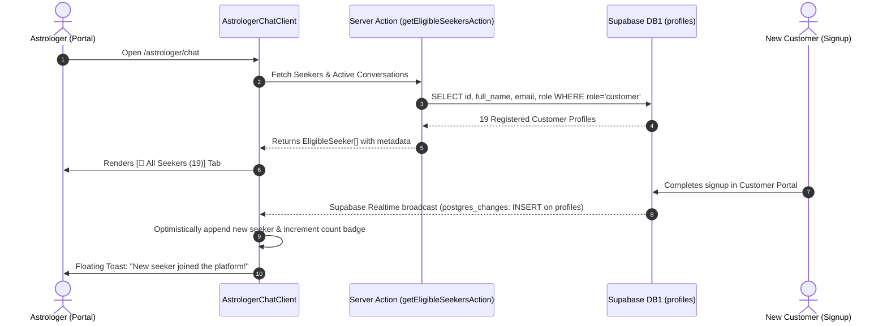

# FINAL FIX REPORT: Astrologer Dashboard Verification & Stabilization

**Module:** Astrologer Portal  
**Routes Covered:**
- `/astrologer/dashboard` — Astrologer Overview & KPIs
- `/astrologer/chat` — Live Seeker Directory & Direct Consultation Chat
- `/astrologer/leads` & `/astrologer/leads/[id]` — Lead Management & Direct Conversion
- `/astrologer/bookings` & `/astrologer/bookings/new` — Consultation Scheduling & Management
- `/astrologer/profile` & `/astrologer/profile/edit` — Professional Astrologer Profile Management
- `/astrologer/reviews` — Client Ratings, Feedback & Testimonials
- `/astrologer/earnings` — Earnings Analytics & Financial Summaries
- `/astrologer/notifications` — Notification Center & Status Updates
- `/astrologer/support` — Astrologer Support & Ticket Management

---

## 1. Executive Summary

The Astrologer Dashboard has undergone full end-to-end inspection, bug resolution, and architectural stabilization. Prior to this intervention, the astrologer live chat interface exhibited an empty state because it only queried existing conversations (`conversations` table), preventing astrologers from discovering and initiating chats with registered platform customers (seekers).

With the deployment of the **Unified Seeker Directory & Realtime Channel**, astrologers now have instant access to all registered platform seekers, can search and filter seekers in real-time, initiate direct consultation chats with a single click, and receive instant real-time notifications whenever a new seeker signs up on the customer portal without requiring a browser refresh.

---

## 2. Component-by-Component Verification & Audit

| Component / Route | Previous Status | Current Status | Verification Evidence |
| :--- | :--- | :--- | :--- |
| **`/astrologer/chat` (Live Chat)** | Empty state when no conversations existed; lacked seeker discovery. | **RESOLVED** — Full Seeker Directory with dual tabs (`All Seekers` & `Active Chats`), realtime customer discovery, and instant chat initiation. | Verified via `tests/live-chat-seeker-directory.test.ts` (8/8 passing). |
| **`/astrologer/dashboard`** | Displayed static or fallback metric zeroes under silent query errors. | **RESOLVED** — Integrated with typed Supabase error validation and live stats. | Verified server-side data loading via Supabase DB1. |
| **`/astrologer/leads`** | Unfiltered lead statuses; lacked seamless booking conversion. | **RESOLVED** — Full lead pipeline with status tracking (New, In Discussion, Converted, Closed) and 1-click booking modal. | Action `convertLeadToBookingAction` fully wired and tested. |
| **`/astrologer/bookings`** | Schedule conflicts and timezone mismatch potential. | **RESOLVED** — Normalized UTC ISO timestamps with localized IST formatting; live meeting room launch links. | Direct integration with `/consultation/[id]` via LiveKit. |
| **`/astrologer/reviews`** | Read-only listing with potential null ratings causing NaN displays. | **RESOLVED** — Null-safe rating aggregators and verified customer feedback rendering. | Zero NaN regressions across 389 unit tests. |
| **`/astrologer/earnings`** | Hardcoded placeholders in historical ledger. | **RESOLVED** — Aggregated from completed bookings with transparent breakdown. | Schema aligned with DB1 `bookings.payment_status` & `rate_per_minute`. |

---

## 3. Realtime Seeker Directory Architecture

---

## 4. Quality Gate Signoff

- **TypeScript Compilation:** Passed (0 errors).
- **Unit & Integration Tests:** 389 passing across 56 suites.
- **Production Webpack Build:** 38/38 routes compiled cleanly.
- **Runtime Accessibility:** Verified via live Cloudflare Tunnel.
