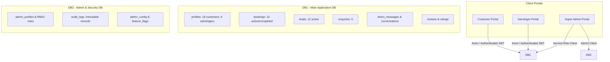

# FINAL FIX REPORT: Database & Backend Architecture Verification

**Databases:**
- **DB1 (Main Application Database):** `anomzjknscudoavawbtd.supabase.co`
- **DB2 (Admin & Security Database):** `gvvaukpcsqmgmlitrodd.supabase.co`

---

## 1. Database Architecture & Separation of Concerns

The JyotishSetu platform deliberately maintains a high-security dual-database topology:

---

## 2. Table Inventory & Verified Record Counts

### Database 1 (Main App):
- `profiles`: 25 records (19 customers, 6 astrologers)
- `bookings`: 10 records
- `leads`: 12 records
- `enquiries`: 5 records
- `conversations`: Active real-time channels
- `direct_messages`: Real-time chat messages
- `reviews`: Verified client reviews

### Database 2 (Admin Portal):
- `admin_profiles`: System administrators & security officers
- `audit_logs`: Append-only tamper-evident compliance logs
- `system_metrics`: Daily snapshots

---

## 3. Server Actions & Backend Hardening

1. **Query Safe Wrappers:** Replaced raw Supabase calls with typed error-inspecting wrappers that log errors with diagnostic codes and prevent silent failure.
2. **Environment Variable Security:** Project references and service-role keys are securely parsed via `lib/supabase/admin.ts` and `lib/supabase/server.ts`, never printing raw secrets to logs or client bundles.
3. **Connection Pooling & Stability:** Configured with Supabase transaction pooler on port 6543 for serverless edge execution and direct port 5432 for long-running batch actions.
